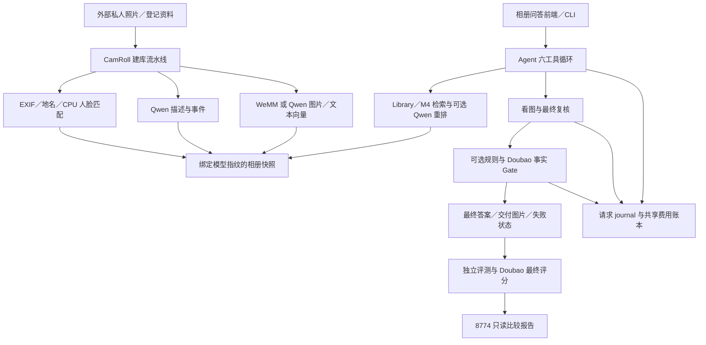

# WeMM–CamRoll 相册系统

**2026-10-14最新交接与采用方案：** [完整交接文档](docs/PROJECT_HANDOFF_20261014.md)。采用 **WeMM + qwen3.7-flash + M4 + Gate-Off**，保留原有校验、M4最终复核和Doubao外部评分；Gate-On保留为历史对照。本文后面的四组实验是历史未完整状态，不是下一步自动执行计划。

这是相册建库、图片／文字检索、多模态 Agent 问答、证据 Gate、PhotoBench 评测与报告服务的完整源码仓库。包含原 WeMM 工程、CamRoll 改造、Qwen 检索 worker、锁定的第三方实现、前后端、测试和部署监督器。

**当前架构版本：`architecture/2026-10-07-v1`。** 本版基于已部署源码 `d49489fc33fde5e149d9be4a2a6aea9e4333b791` 整理完整阅读入口及非权重模型架构材料；不修改冻结实验的模型、提示词、Gate、评分或停止规则。正式实验尚未全部完成，不能把源码发布当作评测验收通过。

仓库不包含模型权重、私人图片／人脸参考照、QA／GT、原始向量、数据库、密钥或逐题运行记录。源码完整不代表已携带这些外部运行资源。

## 从这里阅读

| 文档 | 用途 |
|---|---|
| [当前完整架构](docs/ARCHITECTURE_CURRENT.md) | 建库、检索、问答、Gate、费用、评测、服务与资源恢复的数据流 |
| [源码地图](docs/CODE_MAP.md) | 按职责定位真实模块、类、入口与测试 |
| [模型及外部依赖](docs/MODEL_DEPENDENCIES.md) | WeMM／Qwen 架构实现、来源锁、权重与运行文件的边界 |
| [ChatGPT 云端阅读指南](docs/CLOUD_READING.md) | 私有仓库授权、验证访问、阅读顺序与云端运行限制 |
| [本版本说明](docs/releases/2026-10-07-architecture-v1.md) | 本次范围、冻结版本、当前实验状态与发布校验 |
| [工作约定](AGENTS.md) | 私人数据边界、实验不可变性、GPU 与费用规则 |
| [历史恢复说明](RESTORE.md) | 2026-09-16 基线恢复；不能直接应用于当前源码校验 |

## 系统结构



| 目录 | 内容 |
|---|---|
| [`camroll/camroll-agent/camroll_agent/`](camroll/camroll-agent/camroll_agent) | 建库、索引、Library、六工具 Agent、云客户端、Gate、账本与请求持久化 |
| [`camroll/camroll-agent/camroll_eval/`](camroll/camroll-agent/camroll_eval) | 冻结协议、runner、最终 Judge、指标、续测来源、报告 API 和页面 |
| [`camroll/camroll-chat/`](camroll/camroll-chat) | 8773 相册问答页面、同源代理和受限图片读取 |
| [`wemm/`](wemm) | 原 WeMM 后端、单 GPU worker、预处理、前端及锁定的官方代码 |
| [`deployment/`](deployment) | 隔离部署、GPU1 租约和恢复、Qwen worker、四组／Gate／续测及只读报告入口 |
| [`deployment/vendor/qwen_vl/`](deployment/vendor/qwen_vl) | Qwen embedding／reranker 的锁定实现与兼容修补说明 |
| [`docs/`](docs) | 当前架构、冻结协议和版本说明；`docs/project/` 是历史资料 |
| [`baseline/`](baseline) | 2026-09-16 源码采集清单与当时环境信息 |

## 当前实验与历史边界

2026-09-30 四模型实验各自冷建库，比较 Qwen embedding＋reranker 和 WeMM；生成配置含当时的 Flash／Max。源码保留这些历史能力及记录读取入口。

当前 Flash Gate 实验仅使用 **qwen3.7-flash、qwen3.8-flash 和 Doubao Seed 2.0 Lite**。四组共享一个冻结 WeMM 快照，分别开启／关闭 Gate；不重新建库，不调用 Max。固定 M4、Agent 并发 1、最终 Judge 并发 4、每轮 600 秒、每组 100 题／111 轮，费用上限沿用原累计账本 **600 元**。详见 [Flash Gate](deployment/FLASH_GATE.md)、[首次独立续测](deployment/GATE_CONTINUATION.md) 和 [剩余组入口](deployment/GATE_REMAINING_RUNBOOK.md)。

截至 2026-10-07 12:43（Asia/Shanghai）最后验收：F37-Off、F37-On 均执行 111 轮；F38-Off 执行 1 轮、F38-On 执行 8 轮后触发本地上下文保护，整体 **231/444 轮，未完整交付**。两次窗口已恢复、GPU1 已释放、8774 只读报告保留。该观测不是实时健康承诺。新版本发布不授权补跑或改变冻结停止规则。

## 阅读与离线验证

读取源码和架构文档不需要任何权重、云密钥、私人相册或服务器连接。运行常规组件回归建议使用独立 Python 3.10／3.11 环境（既有Linux验收使用3.10）；报告UI回归还需要PATH中有Node.js，缺少时相关测试会跳过。安装阶段需要软件包源或本地wheel，测试阶段不调用真实模型：

```bash
python3.10 -m venv .venv-review
.venv-review/bin/python -m pip install -r camroll/requirements-wemm.txt
.venv-review/bin/python -m pip install --no-deps -e camroll/camroll-agent
PYTHONPATH=camroll/camroll-agent:.:deployment .venv-review/bin/python -m pytest -q camroll/camroll-agent/tests camroll/tests deployment
```

这些测试的真实模型接口使用替身，不等于 GPU 推理或线上验收。生产环境依赖锁位于 [PhotoBench 锁](deployment/requirements-linux-py310.lock)、[Qwen worker 锁](deployment/qwen_model_worker.freeze.txt) 和 [WeMM 锁](wemm/requirements.lock)。各环境互相隔离，不把所有依赖装进同一个虚拟环境。

真实建库、问答、Gate 和 Judge 均可能收费或写入状态。`deployment/*suite.py`、续测脚本与配置包含既有主机路径及冻结来源校验，不能在云端直接当作通用启动器运行。当前 8774 报告不挂载收费问答接口；8773 相册问答是另一个服务。

## 发布与来源

本版本采用 Git 提交、不可移动的新标签和仅含 Git 文件的源码发布包。发布包附逐文件 SHA256 清单；运行数据和凭据在仓库外独立保存。禁止使用历史 [`wemm/scripts/package_delivery.py`](wemm/scripts/package_delivery.py) 制作 GitHub 发布包，它的旧范围可能包含运行数据。

原基线标签 `baseline/2026-09-16-pre-photobench` 保留不动。[基线清单](baseline/source_manifest.json) 只适用于对应旧标签，不能拿它验证当前改造后的文件。第三方代码、模型来源与既有许可见 [THIRD_PARTY.md](THIRD_PARTY.md)，不因本次发布重新许可。
