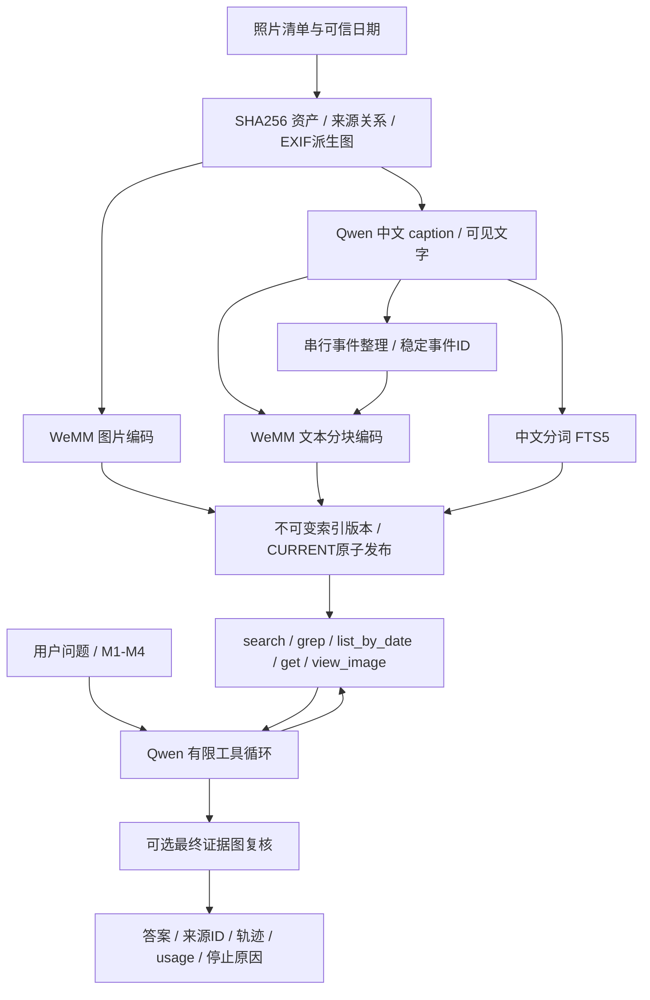

# 实现映射与验证边界

实施日期：2026-09-15。基于上游 `thaoshibe/camroll` 的 `1967f977dbd51ce3f3b3b0d3213d21a514e55dfd`，保留五工具和 Python `Agent.ask()`，重写建库、索引和模型默认接入。运行结果单独保存在新 run 目录，不能用本设计文档代替实际验收。

## 架构

CamRoll 不加载本地模型。云请求在自己的 Python 进程发出；WeMM API 将编码交给已加载的 worker。没有 FAISS、第二份 WeMM、旧 RAG 权重下载、新人脸/OCR/重排模型。

## 文件与职责

| 文件 | 实现 |
|---|---|
| `camroll_agent/qwen.py` | 固定 Qwen3.7-Flash、原生 tool_calls、图片传递、JSON Schema 与能力降级、传输重试、单题请求范围 |
| `camroll_agent/budget.py` | SQLite 原子预留/结算、并发与重试费用、不确定调用保留预留、上限不能被重开账本提高 |
| `camroll_agent/pipeline.py` | 来源白名单、内容去重、分阶段缓存、并行caption/串行编码、串行事件、文本分块、原子发布 |
| `camroll_agent/library.py` | 固定快照、日期预过滤、图片/图文检索、事件聚合、中文FTS、严格ID取图 |
| `camroll_agent/agent.py` | 同步与流式共用状态机、参数纠错、重复结果缓存、无进展/资源停止、最终图像复核 |
| `camroll_agent/schemas.py` / `tools.py` / `prompts.py` | 五工具协议、错误字段反馈、可信ID与公开证据、看图结构化结果 |
| `camroll_agent/wemm.py` | 已有WeMM的HTTP客户端、鉴权、指纹校验、4096维归一化向量校验 |
| `camroll_agent/service.py` / `cli.py` | 轻量问答API、SSE、相册导入/预处理/续跑/索引命令 |
| `deployment/wemm_internal.py` | 仅API层内部编码与无损分块接口，复用单GPU worker |
| `scripts/evaluate_retrieval.py` | 冻结800题评分、逐题差异、固定参数和事件分组bootstrap |

文件路径均相对 `camroll-agent/`，`deployment/` 和 `scripts/` 除外。

## 配置与升级矩阵

| 配置 | 图片召回 | caption召回 | 最终证据图复核 | 定位 |
|---|---|---|---|---|
| M1 | 是 | 否 | 否 | 默认基线 |
| M2 | 是 | 否 | 是 | 证据传递对照 |
| M3 | 是 | 是，等权RRF | 否 | 检索对照 |
| M4 | 是 | 是，等权RRF | 是 | 两项可选增强组合 |

每路Top-50、RRF常数60，按资产ID去重；文本多块取最高分。事件检索融合成员照片排名与事件文本排名；`kind=both` 图片/事件按排名交错、图片优先。照片评测固定 `kind=images`。查询超过512 token明确报错，交给Agent缩短；候选文本按精确token数分块，不截断。

| 层级 | 实现状态 | 取舍 |
|---|---|---|
| P0 模型替换、稳定ID、有限纠错 | 已实现 | 保留工具入口，使用新存储；旧CamRoll记忆需重建 |
| P1 缓存、可恢复阶段、中文FTS、向量缓存、费用记录 | 已实现 | 默认caption并发4；照片直接编码不依赖caption成功 |
| P2 双路召回、最终证据图复核 | 已实现开关 | 是否更好由实测决定，不默认宣称质量收益 |
| P3 局部裁剪、多跳、联合图文向量 | 未实施 | 等出现具体失败样例后再选择 |
| P4 ANN、降维、批量编码 | 未实施 | 当前334图缺乏此类瓶颈证据 |

## 可恢复建库

`enrich` 在 WeMM 暂不可用时仍可生成 caption/事件，不发布索引；恢复后 `build --resume` 复用成功阶段。`index` 只对已经发布的库重编码，不调用Qwen。Caption失败保留失败状态，图片仍可进入图片索引，双路报告文本覆盖率；完全没有图片向量时拒绝发布。

SHA256仅标识内容，源路径、文件名、相册来源和日期另存。事件ID由首图锚点及相册分配，名称和成员关系分离。输入日期优先，其次EXIF；不接受模型补猜日期。预处理分别保存原始字节、供Qwen看的派生图和与旧WeMM实验一致的默认JPEG派生图。

快照通过 `CURRENT` 原子切换；已发出的问答持有原版本。缓存包含资产、模型/指纹、提示词、预处理、文本内容及事件上下文。每轮执行有独立run_id；云预算使用共享账本，不按run_id重置。

## 错误语义与限制

- Caption最多3次结构生成尝试；单次传输最多3次。工具参数最多2次纠正机会，计入决策轮数；无效参数不会被替换为空对象执行。
- 每题25决策轮、50次真实云请求、5次看图、180秒。V1最多追加一次最终生成，含最多6张实际证据图。网络重试仍占总请求/费用额度。
- 成功重复工具调用复用结果；失败重复调用不反复执行；连续两轮无新证据要求换策略，仍无进展则终止。
- `tool_error`、`timeout`、`budget_exhausted`、`request_limit`、`insufficient_evidence` 等各自保留。关键词零结果只说明索引文本没有匹配。
- `stopped_reason=ok` 仅表示正常结束。问答接口与图片传递通过检查，不等于最终答案准确率已经测量。

## 研究依据

采用 [Qwen结构化输出](https://help.aliyun.com/zh/model-studio/qwen-structured-output) 与 [Qwen-Agent](https://github.com/QwenLM/Qwen-Agent) 的原生工具/本地校验思路；借鉴 [Immich后台任务架构](https://docs.immich.app/developer/architecture/) 的阶段依赖；通过 [WeMM](https://github.com/Tencent/WeMM-Embedding) 与固定 [RRF](https://cormack.uwaterloo.ca/cormacksigir09-rrf.pdf) 做双路检索；保留 [VisRAG](https://github.com/OpenBMB/VisRAG) 式图片证据复核选项以及事件/照片两层表示。上述资料为设计依据，不直接构成本相册收益的证据。
