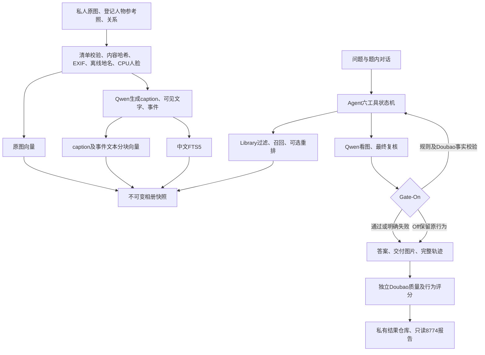

# CamRoll–WeMM 当前完整架构

文档日期：2026-10-07（Asia/Shanghai）。本文按仓库源码整理，描述建库、查询、模型、Gate、评测、部署与恢复的完整连接关系。阅读文件定位见 [CODE_MAP.md](CODE_MAP.md)。源码版本以本文件所属 Git 提交为准；下文运行状态是已有验收记录的时间点，不能代替实时健康检查。

仓库包含可阅读、可修改、可测试的应用代码、模型自定义实现与依赖锁，不包含权重、私人媒体、身份参考图、QA/GT、向量、数据库、凭据或逐题运行记录。因此克隆仓库可以理解完整架构、运行不依赖私有数据的测试，但不能直接恢复已有相册或执行真实模型调用。[模型结构及外部文件边界](MODEL_DEPENDENCIES.md)、[恢复所需材料](../RESTORE.md)和[第三方来源及许可](../THIRD_PARTY.md)分别管理。

## 1. 系统边界与当前版本

这是一份包含两个原项目的源码仓库：

| 仓库目录 | 责任 | 原部署根目录 |
|---|---|---|
| [camroll/](../camroll/) | 建库、相册索引、Agent、云模型调用、评测和问答页面 | `.100:/home/realmagic/camroll-wemm` |
| [wemm/](../wemm/) | 原 WeMM API、队列、单 GPU 编码、原检索前端 | `.100:/home/realmagic/wemm-embedding-lab` |
| [deployment/](../deployment/) | 独立 release、GPU 窗口、实验监督器、只读报告 | CamRoll release 根目录 |
| [baseline/](../baseline/) | 2026-09-16 来源文件清单和环境存证 | 源码基线材料，不是当前运行数据 |
| [docs/project/](project/) | 原样保存的历史交接资料 | 历史说明，不是当前执行入口 |

当前代码同时保留两套实验入口：

1. **历史四模型实验**：Q37、Q38、W37、W38Max，分别冷建库；Qwen 向量与重排已经实现。配置见 [experiment.py](../camroll/camroll-agent/camroll_agent/experiment.py)，协议见 [四模型协议](PHOTOBENCH_QWEN_PROTOCOL_V1.md)。
2. **当前 Flash Gate 实验**：F37-Off、F37-On、F38-Off、F38-On，共享冻结的 WeMM 索引，只改变推理模型和 Gate 策略；不重建描述、事件或向量，不调用 Max。配置见 [gate_experiment.py](../camroll/camroll-agent/camroll_eval/gate_experiment.py)，运行规则见 [FLASH_GATE.md](../deployment/FLASH_GATE.md)。历史索引中保留 W38Max 的来源信息，不表示 Flash Gate 正在调用该模型。

2026-10-07 12:43 已归档的正式状态：

| 组别 | 推理模型 | Gate | 已执行轮次 | 状态 |
|---|---|---|---:|---|
| F37-Off | qwen3.7-flash | 原有校验/修复 | 111/111 | 已完成必要评分 |
| F37-On | qwen3.7-flash | repair-evidence-v1 | 111/111 | 已完成必要评分；包含原故障及继承记录 |
| F38-Off | qwen3.8-flash | 原有校验/修复 | 1/111 | 本地发送前 `context_limit` 阻断 |
| F38-On | qwen3.8-flash | repair-evidence-v1 | 8/111 | 本地发送前 `context_limit` 阻断 |

本版四组比较**尚未完整**，剩余 213 轮未执行。两种 F38 的阻断与工具记录大量重复、保守上下文估算有关，不能当作模型回答能力的完整比较。冻结执行器仍将 `context_limit` 视为停组条件，本次架构归档没有修改该行为。GPU1 及原服务已恢复进入前状态，8774 保留只读报告。上述是历史观测，不保证读者打开仓库时服务仍在线。

## 2. 主要数据流

向量服务在两个后端中择一：WeMM 通过 8765 的内部接口；Qwen Embedding/Reranker 通过独立回环 18778。生成和视觉理解走云端 Qwen。CPU 人脸匹配与日期、地点、FTS 检索不是语义向量替换的一部分。

## 3. 建库、元数据与不可变快照

[pipeline.py](../camroll/camroll-agent/camroll_agent/pipeline.py) 统一承载 `build`、`enrich`、`encode_images`、`reindex`。阶段缓存键绑定输入哈希、预处理/提示版本、模型指纹和实验配置；失败与缺失状态保留。图片描述并发 4，事件与文本向量按既定顺序处理。`enrich` 不发布向量快照；`reindex` 不重新调用云模型生成描述。

[metadata.py](../camroll/camroll-agent/camroll_agent/metadata.py) 提取 EXIF 时间/GPS，记录精度、时区和来源，并使用离线地名库。[identity.py](../camroll/camroll-agent/camroll_agent/identity.py) 使用外置 `buffalo_l` ONNX 文件进行 CPU 检测与登记参考照匹配，保留匹配分、未知状态、人物登记和关系；身份匹配不等同于事实保证。正式建库清单禁止把逐图 QA/GT 标签作为输入。

相册中的关键数据契约：

| 产物 | 内容与约束 |
|---|---|
| `state.sqlite` | 来源、阶段缓存和建库运行状态；不是费用账本 |
| `assets/` | 内容寻址后的受控资产及预处理结果；原图与派生图分开记录 |
| `snapshots/<version>/records.json` | `images`、`events`、`vector_ids`、`metadata` |
| `snapshots/<version>/vectors.npz` | `image`、`caption`、`event` 三路 float32 矩阵，行数与 ID 映射一致 |
| `snapshots/<version>/search.sqlite` | 同版本中文 FTS5，建库与查询都使用锁定 jieba 分词 |
| `CURRENT` | 原子替换的 32 位版本指针；已构建的 Library 实例继续固定其原版本 |

图片使用 `img_…` 稳定 ID，事件使用 `ev_…` ID。图片记录保留原图/派生图路径、来源列表、日期地点、登记身份证据、caption/可见文字及事件关联；模型通过 ID 操作，不提供任意文件路径。事件保留成员图片 ID、日期范围、名称和描述。`vector_ids` 允许同一记录有多个文本块；检索按记录取最大相似度。

元数据绑定 embedding 维度、指纹、预处理版本、生成模型、实验配置及哈希、缓存命名空间、向量哈希和覆盖率。[Library](../camroll/camroll-agent/camroll_agent/library.py) 构造时检查矩阵有限性、维度、映射、哈希和配置；查询时继续核验活跃后端指纹。发布采用临时目录及原子替换；指纹或维度不一致不发布新快照。旧无实验配置的相册保留兼容读取路径。

## 4. 语义检索与 M1–M4

[retrieval.py](../camroll/camroll-agent/camroll_agent/retrieval.py) 选择检索客户端；[runtime_clients.py](../camroll/camroll-agent/camroll_agent/runtime_clients.py) 把通用建库/CLI 客户端绑定到实验或已发布快照。

| 配置 | 召回 | 最终复核 |
|---|---|---|
| M1 | 图片向量 | Agent按需看图 |
| M2 | 图片向量 | 增加最终图片复核 |
| M3 | 图片和caption双路；事件融合成员图片及事件文本 | Agent按需看图 |
| M4 | 与M3相同 | 增加最终图片复核，最多6张 |

M4 首先按日期、可信地点和登记人物过滤，每路 Top-50，RRF 常数 60。文本块对同一记录取最大相似度；事件的图片分支来自符合过滤条件的成员图片。图片与事件分支交错，再取 `top_k`。`grep` 使用中文 FTS5；`list_by_date`、`get`、人物查询沿用元数据路径。

| 后端 | 编码入口 | 文档分块 | 重排 |
|---|---|---|---|
| WeMM | [wemm.py](../camroll/camroll-agent/camroll_agent/wemm.py) → 8765 | 原 tokenizer，最多512 token，保留原预处理/4096维 | 无 |
| Qwen | [qwen_retrieval.py](../camroll/camroll-agent/camroll_agent/qwen_retrieval.py) → 18778 | 自身 tokenizer，无损分块，最多2048 token/2048维 | Qwen3-VL-Reranker-2B |

编码角色显式区分 `document` 与 `query`；查询不自动分块，超限明确失败。Qwen 覆盖原图、caption/可见文字、事件和查询向量。融合后分别重排前30张图片和前30个事件：图片同时提供真实图片与文字，事件提供名称/描述；长文分块得分取最大值。分支按重排分降序，同分按稳定 ID；范围外尾部保留原顺序且标记未重排。审计保留召回名次、重排分、最终名次。重排错误不会悄悄回退旧排序。

## 5. WeMM 与独立 Qwen worker

WeMM 既有实现由 [backend/app.py](../wemm/backend/app.py)、[worker.py](../wemm/backend/worker.py)、[encoder.py](../wemm/backend/encoder.py)、[preprocess.py](../wemm/backend/preprocess.py) 组成。CamRoll 扩展 [camroll_internal.py](../wemm/backend/camroll_internal.py) 提供回环且需会话认证的 `/api/internal/embeddings`、`/api/internal/tokenize`，把任务提交给**既有同一 worker 队列**，不加载第二份模型。路径白名单、token限制、输入体积和队列状态在服务端校验。

WeMM 官方来源、固定模型 revision、文件哈希及实际依赖记录在 [SOURCE_LOCK.json](../wemm/SOURCE_LOCK.json)；[official-locked/](../wemm/official-locked/) 保存官方代码与许可。本版另以 [model-code/](../wemm/model-code/README.md) 保存外置模型目录原有的自定义Python、结构配置及模板，供阅读其内部池化/归一化与Transformer连接关系；来源逐文件校验，不复制权重，不改变encoder实际加载路径。原 encoder、worker、预处理、模型配置及旧索引仍是部署保护对象。

[qwen_worker.py](../deployment/qwen_worker.py) 是 CamRoll 专用 FastAPI worker，回环端口18778，接口为 `/health`、`/fingerprints`、`/encode`、`/tokenize`、`/split_text`、`/rerank`、`/unload`。它只读引用外置 Qwen3-VL-Embedding-2B 和 Qwen3-VL-Reranker-2B 权重，不修改 WeKnora 项目。图片白名单、独立缓存命名空间、telemetry 和模型文件校验属于 worker 边界。

Qwen vendor 来源固定在 [vendor锁](../deployment/vendor/qwen_vl/SOURCE_LOCK.json)，兼容补丁另见 [COMPATIBILITY_PATCH.json](../deployment/vendor/qwen_vl/COMPATIBILITY_PATCH.json)。`rope_deltas` 在 worker 每次独立推理前重置，防止前一次图像状态污染后续文本输入；该修复不修改 WeMM。worker 串行执行，Embedding 与 Reranker 单模型驻留并换载；它与 WeMM 也由 GPU 窗口互斥调度。

## 6. Agent 六工具与 Gate

[agent.py](../camroll/camroll-agent/camroll_agent/agent.py) 为同步及流式调用提供同一状态机。[schemas.py](../camroll/camroll-agent/camroll_agent/schemas.py) 定义参数契约，[tools.py](../camroll/camroll-agent/camroll_agent/tools.py) 连接 Library/VLM，[prompts.py](../camroll/camroll-agent/camroll_agent/prompts.py) 固定提示与工具观察格式。

| 工具 | 作用 |
|---|---|
| `search` | 语义召回、过滤及可选重排 |
| `grep` | caption、可见文字、事件等文本的 FTS 检索 |
| `list_by_date` | 日期与元数据筛选、分页 |
| `get` | 读取实际已返回的稳定 ID 记录 |
| `view_image` | 读取白名单图片/有效人物裁剪，调用VLM，返回结构化观察 |
| `query_photo_people` | 查询已保存的人脸、登记人物及匹配证据 |

Agent 区分已召回、已复核和最终交付图片。最终正文引用必须与交付列表、复核集合一致。工具批次执行前验证参数和允许 ID；成功工具不因输出修复重复执行。人物裁剪只接受登记资料或实际工具返回的参数。连续无进展、最多25决策步、最多5次看图、每轮最多50次实际云请求和600秒期限共同限制执行；失败不是正常拒答。

Gate-Off 保留原校验/修复。Gate-On 使用 [OutputGate](../camroll/camroll-agent/camroll_agent/gate.py) 统一逻辑输出的最多4次尝试：首次、完整请求原样重发一次、冻结分类修复、最后修复。第二次使用新请求身份并核对完整 payload 哈希；journal 回放不计作真实重发。修复共用本轮时间与请求额度，不叠乘旧循环。

[EvidenceGateVerifier](../camroll/camroll-agent/camroll_agent/evidence_gate.py) 是独立 Doubao 事实校验器，只接收当前问题、候选答案、实际交付列表、最多6张本轮复核原图和带来源文字。原图/可信元数据为主要证据；caption、事件和模型观察为派生证据。GT、参考答案、最终 Judge 分数不进入此边界。返回 `supported`、`contradicted` 或 `insufficient` 及证据引用，不提供标准答案。

每个完全相同的候选及证据最多取得一次有效判定，正负判定均可在本轮缓存；仅校验器格式错误允许一次格式修复，之后记为校验器故障。正常且有依据的拒答/澄清可以通过。通过 Gate 不保证事实正确；本版存在校验器格式失败和上下文膨胀的已知问题，不能把“代码已接入”当成“质量已提升”。

## 7. 推理配置、账本与请求身份

历史 `ExperimentProfile` 将生成模型和索引参数整体冻结。Flash Gate 新增相互独立的 `IndexBinding` 与 `InferenceConfig`：前者固定原相册、资产边界、来源 run、快照和文件哈希；后者固定 Flash 型号、Gate策略、M4、并发、600秒、温度0/关闭思考和预算上限。这样两种Flash可以查询同一WeMM快照，而不伪造索引生成模型或改写指纹。

[qwen.py](../camroll/camroll-agent/camroll_agent/qwen.py) 参数化型号、能力缓存、上下文、输出限制、价格和实际响应型号；上下文保护在发送前运行，云请求不自动换型号。价格是已冻结版本的等价费用估算，不能视为当前套餐实付账单。

[budget.py](../camroll/camroll-agent/camroll_agent/budget.py) 提供共享 `BudgetLedger` 与各 run 独立 `RequestJournal`：

1. 发送前持久化请求身份、payload哈希，并原子预留费用。
2. 已完成请求可回放；同身份但不同payload拒绝。
3. 响应及usage明确后按实际用量结算；流中断、结果未知或usage缺失保留预留并阻断新付费提交。
4. 当前实验共用原累计 `runtime/budget.sqlite`、上限¥600；普通打开不重置上限，代码/相册回滚不回退消费，其他客户端更改上限会阻断。

既有未知请求只有在用户明确授权、精确绑定原ledger/journal文件身份、请求及行哈希、完整预留的 `UncertainRequestAcknowledgement` 下才能跳过并独立续测。这个机制不代表请求结算，不重发该请求、不释放预留，也不允许忽略新未知请求。生产凭据与该授权记录只在私有运行目录保存。

## 8. 评测、继承续测与报告

[Dataset](../camroll/camroll-agent/camroll_eval/dataset.py) 与 [Runner](../camroll/camroll-agent/camroll_eval/runner.py) 管理输入校验、100题/111轮计划、建库、题内多轮历史和并发评分。Flash 的 [GateRunner](../camroll/camroll-agent/camroll_eval/gate_experiment.py) 固定355图、8人物参考照、6关系、19不可回答题和81题媒体指标分母；Agent并发1、最终Judge并发4。题内历史可共享，题间及组间隔离。

最终 [Judge](../camroll/camroll-agent/camroll_eval/judge.py) 通过 [冻结提示词](../camroll/camroll-agent/camroll_eval/judge_prompts.json) 评质量与任务行为；图片证据Judge关闭。事实Gate与最终Judge都使用Doubao，但提示、输入和请求身份分离，报告披露同模型关联。正常回答、拒答和澄清可评分；系统故障兜底、Gate耗尽、未执行轮次不作为正常拒答送评。

[metrics.py](../camroll/camroll-agent/camroll_eval/metrics.py)、[gate_metrics.py](../camroll/camroll-agent/camroll_eval/gate_metrics.py) 同时输出固定100题正确率/质量分布、有效评分数/固定分母均分、81题交付宏P/R/F1、候选召回及重排诊断、Gate各阶段恢复率、错误分类、Token/费用与耗时。执行完成与财务结算是不同字段；必要评分齐全也不表示每道题回答正确。

[gate_continuation.py](../camroll/camroll-agent/camroll_eval/gate_continuation.py) 只接受精确SHA绑定的特定父run，验证连续已执行前缀、原始尝试、评分及题内对话，把继承来源写入新run；不修改旧结果，不重做成功工具或评分。它不是对任意失败通用的自动续跑。[独立续测监督器](../deployment/gate_continuation.py) 与[仅剩余组监督器](../deployment/gate_remaining.py) 各有冻结边界；后者只允许原先尚未开始的F38-On。

私人运行契约包含 `run.json`、完整计划、`turn_attempts/`、`results.jsonl`、`model_calls.jsonl`、`gate_events.jsonl`、`verifier_calls.jsonl`、`judge_calls.jsonl`、`request-journal.sqlite` 和恢复收据。源码仓库只保留读写这些产物的代码。报告通过 [Repository](../camroll/camroll-agent/camroll_eval/repository.py) 读取，核验协议、输入、索引与指定来源集合后才允许比较；历史M1和历史补测不混入同一正式四组结果。

## 9. 服务边界、GPU监督与恢复

| 端口 | 服务/入口 | 能力和边界 |
|---|---|---|
| 8765 | [WeMM API](../wemm/backend/app.py) | 旧前端/检索及回环内部编码；部分检索会写SQLite事件 |
| 8770 | [CamRoll service](../camroll/camroll-agent/camroll_agent/service.py) | 原相册问答 `/api/ask`、请求状态和健康接口 |
| 8772 | [评测service](../camroll/camroll-agent/camroll_eval/service.py)、[run_eval.py](../deployment/run_eval.py) | 独立PhotoBench应用；普通模式可挂载Agent并启动/取消评测，会产生费用 |
| 8773 | [CamRoll Chat](../camroll/camroll-chat/camroll_chat/app.py) | 独立用户问答页面、受控图片读取和同源流式代理；调用8772且共用账本 |
| 8774 | [gate_remaining_report.py](../deployment/gate_remaining_report.py) | 当前只读报告入口，`read_only=True`、`mount_agent=False`；写请求405，不加载收费问答 |
| 18778 | [Qwen worker](../deployment/qwen_worker.py) | 回环图片/文本编码与重排；受GPU窗口约束 |

端口表描述架构，不表示所有服务同时运行。8774不占GPU，绑定冲突直接失败，不杀端口占用者，不自动切换8773。8773只是页面及代理，不能凭“索引只读”推断问答不收费。[CHAT.md](../deployment/CHAT.md) 与 [deployment/README.md](../deployment/README.md) 分别给出服务管理边界。

[four_gpu_window.py](../deployment/four_gpu_window.py) 是后续四模型、Gate及续测共用的GPU窗口基础：独立window ID、共享所有权登记、600秒租约、30秒续租、独立watchdog；校验PID、启动tick、cwd、命令行与端口所有权后才管理自有进程。只使用物理GPU1及固定UUID，逻辑`cuda:0`只是可见卡映射；不控制GPU0。

进入前记录服务状态和受保护源码/索引/模型哈希，验证GPU空闲或已知归属。成功、失败、中断、owner退出或租约到期均走恢复：清理本轮进程，恢复进入前WeMM状态，原来停止则结束仍停止，核对哈希与无残留。清理或恢复失败不得标记成功。账本、新run及审计产物始终保留。

## 10. 阅读与运行边界

阅读源码不需要访问原服务器。优先从 [CODE_MAP.md](CODE_MAP.md) 的调用链进入；上游保留的 `store.py`、`vector.py` 和通用 `llm/` 实现不是当前M4快照路径的替代入口。旧文档的300元、五工具、12/12并发等是历史配置，当前Flash协议以本节链接源码与 [FLASH_GATE.md](../deployment/FLASH_GATE.md) 为准。

离线测试入口是 [gate_validate.py](../deployment/gate_validate.py)；它运行 `camroll/camroll-agent/tests`、`camroll/tests` 和 `deployment` 测试，并保存源码清单。8773的独立测试在 [camroll-chat/tests](../camroll/camroll-chat/tests/)。依赖分别见 [PhotoBench依赖](../requirements-photobench.txt)、[Linux锁](../deployment/requirements-linux-py310.lock)、[Chat锁](../camroll/camroll-chat/requirements-linux-py310.lock)、[Qwen worker锁](../deployment/qwen_model_worker.freeze.txt) 和 [WeMM来源锁](../wemm/SOURCE_LOCK.json)。

真实运行还需要外置权重、合法私人输入、受限配置、已有累计账本、指定GPU及通过验收的独立release。套件脚本含原部署路径和冻结来源校验，是受控部署入口，不是克隆后可直接运行的公共演示。需要新环境时应准备独立合成数据和配置适配，再执行验收；不得删除claim或改写旧run来绕过保护。

本次架构新版本只归档源码和说明，不重跑评测、不更改模型/提示/Gate规则、不把未完成实验标记为完整，也不发布私人运行材料。
