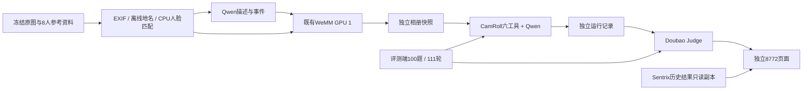

# 独立 PhotoBench 协议

协议日期：2026-09-16。部署和实验结果以对应 run 的记录为准；本文描述实现契约，不预先宣称实验成功。

## 数据与系统边界

- 目标：`album3-max / 100qa-full`，355 张原图、8 张命名参考照、6 条关系、100 道题／111 轮。
- 建库端只收到原图和身份参考资料。QA、参考答案、检索 GT、人工事件总结与逐图人物标注不进入索引。
- 输入 manifest、原图、参考照和 QA 分别保存 SHA256；文件名到内容 ID 的映射由实际建库快照生成。
- `.153` 的数据和历史记录通过只读复制形成冻结副本。评测不调用其业务问答、模型管理、重新评分或相册管理接口。
- 每次正式运行新建相册和 run_id，Qwen/WeMM 模型可以预先就绪，但不复用先前相册的描述、人物匹配和向量缓存。
- 显式续跑只复用同一运行已完成的阶段，标记为 resumed，时延不再进入完整冷建库比较。

## 元数据与身份

保留 EXIF 完整拍摄时间、精度、来源和 GPS。没有时区标签时保存 `unknown`，不把文件复制时间或默认 UTC 写成拍摄时间。离线地名保存来源、行政层级和邻近城市距离；这些数据不能证明具体公园、店铺或其他 POI。

命名身份只来自参考照登记。buffalo_l 的既有 ONNX 权重通过 CPU provider 加载，记录模型 SHA256、参数和坐标系，不自动下载模型，不占用 WeMM GPU。每张图的匹配状态、相似度、歧义与未处理状态分别保存。相似度不是识别概率或人工确认。

`query_photo_people` 返回逐脸记录、命名匹配、未知人脸数量和已登记关系。`view_image` 可依据保存的匹配 bbox 查看目标人物扩展区域与原图；裁剪不是人体分割，可能包含其他人。亲属关系只读取显式关系表，不由外貌推断。

`search`、`list_by_date` 的结构化人物过滤使用身份结果，地点过滤使用可信元数据。caption 中的外貌和地点推测不升级为身份认证或权威地理记录。身份零匹配不等于人物不存在。

## 问答与观测接口

`Agent.ask` 保留旧调用，新增 `history`、`request_context`、`structured_output`、`stream_model`。独立评测启用结构化输出和真实模型流式统计。

最终模型输出为 `answer`、`outcome=answer|clarify|refuse`、`selected_image_ids`。交付 ID 必须来自已返回证据；正文引用必须属于显式交付。合法澄清和拒答可以不调用工具，不再被通用“没有相册证据”覆盖。

结果分别保存：

- `retrieved_image_ids`：实际工具返回的候选，包括会话中保留的证据。
- `evidence_image_ids`：看图或用于最终结论的证据来源。
- `selected_image_ids`：模型明确交付给用户的图片。
- `conversation_history`：同一道 QA 后续轮所需的完整消息；不同题不得共享。
- `model_call_metrics` 和 `tool_trace`：调用标识、角色、起止、状态、token、TTFT、工具参数与结果、WeMM 内部计时。

`POST /api/ask` 可接受 `conversation_id`、`request_id`、`index_version`。会话绑定相册、配置与快照；同会话并发返回冲突。相同 request_id 与相同请求返回已完成结果，输入冲突拒绝；进行中或中断后不自动重发计费请求。`GET /api/requests/{request_id}` 用于查询记录。会话模式使用普通 JSON HTTP 响应，模型内部仍可流式采集 TTFT。

TTFT 从模型首个文本或工具调用内容增量计算，角色声明或 HTTP/SSE 状态事件不算首 token。非流式调用的 TTFT 留空。工具内视觉模型与主 Agent 分角色统计；WeMM 编码保留实际 HTTP 墙钟和后端时间，不能用最后一次调用覆盖整个过程。

## 评分、费用与比较

评分兼容模块从冻结的 Sentrix 编排器提取纯函数，来源哈希、提示词和评分规则保存在 `camroll_eval/provenance.json`。不执行原脚本顶层业务初始化。

| 指标 | 分母与含义 |
|---|---|
| 正确／部分／错误 | 每个 QA 最终轮 Judge 2／1／0，一题一票；无效评分单列 |
| 完全／核心准确率 | 2 分占比／1或2分占比，同时展示有效数与计划100题 |
| 图片 P/R/F1 | 显式交付对 GT；逐题算值再宏平均；正常范围81道可检索题 |
| 候选召回 | 实际工具返回对 GT，与交付指标分列 |
| 任务行为 | 按111轮的回答／澄清／拒答标注比较 |
| 原生协议合法率 | CamRoll native tool-call/结构化终态校验，不假装是Sentrix动作JSON解析率 |
| 全链路时间 | 身份／输入准备开始到最后Agent结束，不从墙钟减Judge累计耗时 |
| Agent单题时间 | 一题各轮Agent实际耗时；与并发阶段墙钟÷题数分列 |
| GPU/RAM | 指定GPU UUID、可验证WeMM进程、本地评测进程和整机分别记录；云端GPU留空 |

质量和任务行为默认用 `doubao-seed-2.0-lite`，图片证据 Judge 默认关闭。若另用 Qwen，必须为新旧回答生成同一 Qwen Judge 的独立评分版本，不混合排名。

所有新云调用，包括建库、问答、工具视觉、Judge、修正和重试，共用原300元累计账本。请求前预留，已知usage结算，超时或费用不明保留预留。Doubao套餐调用按最高档1.8/10.8元每百万输入/输出token做保守按量等价估算；不声称等同实际账单。价格依据固定于2026-09-16，来源：https://www.volcengine.com/docs/84458/1585097 。回滚不清零或回退账本。

主历史对照为2026-09-11 Gemma4-E2B全链路100题记录。其保存值为39正确／19部分／42错误、均分0.97、图片宏召回12.9%。独立页面同时保留原始保存摘要和统一函数重算摘要。其他历史运行的不同并发、输入版本或缺失时延明确展示，不把历史系统比较表述为同硬件模型速度比较。

## 部署隔离与验证

新服务只使用独立8772、版本化release、新虚拟环境和新runtime；原8765/8770保持原状。2026-09-17 起按用户要求取消页面密钥登录，局域网直接访问记录和图片；写操作仍校验同源。模型 API 凭据仍保存在受限配置中。

验证顺序：基线私有备份及重新clone哈希校验 → 合成组件测试和历史评分回放 → 参考照/GPS组件检查 → 独立样例全链路 → 停止新服务回滚演练 → 冻结版本与正式355图/100题。正式题的标准答案不用于提示词或身份阈值调优。

回滚仅停止已核验PID/cwd/start_ticks的8772进程，原服务和数据不变。运行状态备份、源码标签和费用账本是不同恢复对象，详见根目录 `RESTORE.md`。

## 定点补跑与合并视图（2026-09-17）

完成后的原 run 保持不可变。`camroll-eval repair-qa <parent> --run-id <new> --qa-ids <ids...>` 仅接受原运行中执行失败且没有有效最终评分的题；每题从首轮独立重做一次。入口校验数据、冻结核心代码、Judge协议及原索引，复制并固定原快照，提交前持久化一次性claim。新ID不能绕过同一父运行/题目的claim；中断或不确定调用不得自动重试。

输出独立 `mode=repair` 记录与 `mode=composite` 合并视图。合并仅替换所选题，保留每题来源、未变题哈希、原失败和补跑记录。只有执行完成且最终Judge有效才算补齐；低分不重试。质量/交付指标重算；性能统计沿用首次运行，补跑墙钟/费用和累计尝试轮次单列，不能把跨日期时间拼成一次全链路结果。

`camroll-eval repair-caption <parent> --repair-id <new>` 仅处理原记录唯一的caption失败，保存单图描述和文字向量的派生快照，不改变原相册CURRENT。其他图片、图像向量、事件和事件向量不变，不调用顺序事件聚合；目标图原本未归属事件则继续未归属，明确记录该限制。图片修复快照不供本次三题补跑使用。

历史导入支持full/reuse；reuse要求批准的355图/100QA输入哈希，源文件原样保存。reuse没有建库和全链路计时；原始摘要与统一展示分开。`evaluation/comparison-profile.json` 在私有运行目录选择四条主线与Kimi辅助，不含凭据。CLI补跑使用部署配置包装器，继续原累计费用账本。页面只读展示补跑、合并和单图修复状态，避免页面重复提交付费补跑。
