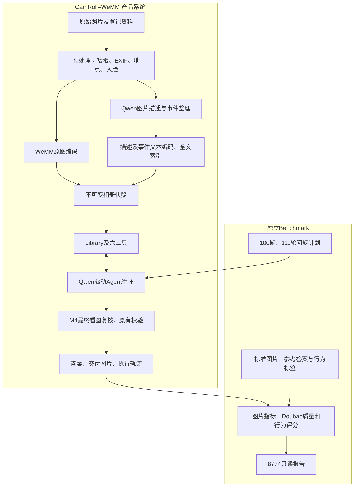

# CamRoll–WeMM 完整交接：Gate-Off 当前方案

**2026-10-15 自建Q6验收终态：** [协议、验收与恢复记录](MINICPM47_Q6_THINKING_20261015.md)。Mac/Linux各1162项通过；基础探针通过，完整30项25通过／5失败，首次结构有效率84.31%；3题与100题按门槛未启动。60次调用均HTTP200、409052 tokens、API费用0；GPU1原任务未动，8774保留13个历史运行。

**2026-10-15 自建Q6 Thinking连接验证：** [SSH/API与三项实际调用](MINICPM47_SELFHOST_CONNECT_20261015.md)。新服务器已连通；文本、原第2张及完整六图均HTTP200，图片严格JSON/ID通过，Thinking独立返回。原云端失败保留；这是连接探针，30项、3题WeMM及100题尚未在新配置运行。

**2026-10-14 16:45 六图逐张与组合定位：** [18次诊断与失败证据](MINICPM47_IMAGE_ISOLATION_20261014.md)。第2张单图3/3被拒；其余5张单图及不含第2张的2至5张组合全部成功，包含第2张的已测组合均返回content_policy_violation。原六图验收仍未通过，100题未启动。本轮55320 tokens／0元，无新unknown。

**2026-10-14 16:32 JSON兼容修复与验收结果：** [400根因、三次复现与最终回执](MINICPM47_JSON_FIX_20261014.md)。system布局和uniqueItems已修复，Mac/Linux各1152通过；30项验收12完成、1失败、17未执行。六图相同请求3/3均content_policy_violation；100题未启动。事实答错已改为非阻断，历史结果保留，本轮68877 tokens／0元，无新增unknown。

**2026-10-14 15:50 SDK默认接入更新：** [Thinking省略测试、独立协议与验收阻断](MINICPM47_SDK_DEFAULTS_20261014.md)。默认文本／真实图JSON可用，但工具final格式、JSON决策接口及OCR准确性未通过能力门槛；30次／3题／100题未启动。Mac/Linux各1107通过、1跳过；本轮28711 tokens／0元，无新unknown。8774已显示新状态并保留历史，GPU1空闲。

**2026-10-14 MiniCPM Thinking 接入：** [实现、真实探针失败与费用交接](MINICPM47_THINKING_20261014.md)。三种JSON模式真实图请求均HTTP 200但content为空，已按门槛停止；30次验收、3题端到端和100题未执行。8774已部署只读MiniCPM状态入口，历史结果保留。15:05按用户新指令终止GPU1上的vLLM任务，显存降至18MiB；15:06固定Thinking On配置仍无content；15:09用户提供的默认SDK文本示例正常返回，详见该交接的追加记录。

文档日期：**2026-10-14，Asia/Shanghai**。适用项目：WeMM–CamRoll 相册问答系统及其独立 PhotoBench 评测。本文是新 Agent 的首读入口；替代旧文档中“默认继续四组 Gate 实验”的工作方向，保留旧实验事实和操作边界。

本地交接目录：`/Users/zhanyiqi/Documents/camwwem/docs_wemm/`。源码仓库中的同版副本：`wemm-camroll/docs/PROJECT_HANDOFF_20261014.md`。配套详细源码阅读地图为源码仓库 `docs/CODE_MAP.md`；旧架构说明为 `docs/ARCHITECTURE_CURRENT.md`，其中运行状态按其标注日期理解。

## 1. 接手后首先要知道的决定

用户于 **2026-10-14** 决定：当前新增 Gate 效果不佳，报告及后续默认方案采用 **Gate-Off**。

| 项目 | 当前采用方案 |
|---|---|
| 语义向量编码 | `tencent/WeMM-Embedding-9B`，4096 维 |
| Agent、看图、最终复核 | 云端 `qwen3.7-flash` |
| 检索/复核模式 | M4 |
| 新增 Gate | `gate_policy=off`；关闭 `repair-evidence-v1` 统一生成修复及 Doubao 事实 Gate |
| 仍保留 | 原有 JSON/参数/ID/资产校验、既有有限修复、M4 最终图片复核 |
| 外部评测 | Doubao Seed 2.0 Lite 的答案质量和任务行为评分继续保留 |
| thinking / 温度 | 当前代码关闭 thinking、温度 0；启用 thinking 需要后续代码与新协议改造 |
| 历史 Gate-On | 保留全部原答案、尝试、失败、分数、费用及未执行状态，作为历史对照 |

**8774 是只读报告，不存在实际问答/Gate 执行开关。** 本次“关闭 Gate”在报告中表现为采用方案明确为 Gate-Off，On 组标为历史对照；没有把历史 On 记录改标成 Off，没有删除失败或重算分数。本次没有启动收费问答、模型、建库或新评测。

后续新运行按 Gate-Off 配置设计。历史 `gate_suite.py` 仍包含四组 Off/On，不能直接拿旧入口当作最新执行计划；现有冻结实验的组别、参数和停止规则不改写。用户本次要求的是交接和报告调整，不等于要求补完旧 F38 两组或重跑正式基准。

## 2. 机器、IP 与项目位置

| 机器 | 登录/地址 | 项目职责及目录 |
|---|---|---|
| 用户 Mac | 2026-10-14 本机 `en1=192.168.1.161`；地址可能变化 | 交接工作区 `/Users/zhanyiqi/Documents/camwwem`；当前源码 `/Users/zhanyiqi/Documents/camwwem/wemm-camroll` |
| GPU/部署服务器 | `realmagic@192.168.0.100`，主机名 `realmagic` | CamRoll `/home/realmagic/camroll-wemm`；WeMM `/home/realmagic/wemm-embedding-lab`；独立问答页 `/home/realmagic/camroll-wemm-chat` |
| 原始数据/Sentrix 服务器 | `asus@192.168.0.153`，主机名 `asus-System-Product-Name` | `/home/asus/Github/Sentrix-Home-Web/services/photobench/data/album3-max-video10/`；原 QA、媒体、登记资料来源，只读 |
| 同机的 WeKnora 项目 | `192.168.0.100` | `/home/realmagic/weknora-album-lab`；CamRoll 仅只读引用其中 Qwen 检索模型及锁定 worker 环境，不改 WeKnora 工程 |

Mac 本次另外观测到 `en0=169.254.229.100`（链路本地地址）、`utun4=198.18.0.1`（隧道接口）；它们不是 CamRoll 服务入口。两台服务器 SSH 在 2026-10-14 重新验证可达，使用 Mac 已有 SSH 配置和密钥；换电脑需重新配置公钥。

```bash
ssh realmagic@192.168.0.100
ssh asus@192.168.0.153
```

工作区根目录不是 Git 仓库，也不是线上服务源码根。`/Users/zhanyiqi/Documents/camwwem/camroll` 与 `/Users/zhanyiqi/Documents/nx/wemm-embedding-lab` 是早期副本，阅读/修改最新版本以 `wemm-camroll/` 为准。不要把同机 WeKnora、Sentrix 与本项目混用。

## 3. 本次实时核验与历史状态的区别

2026-10-14 **13:29–13:32** 只读检查：

- `.100` 和 `.153` SSH 可达；`.153` 原始数据目录存在。
- `http://192.168.0.100:8774/` 返回 HTTP 200；`/api/health` 为 `read_only=true`、`active_run=null`、`source_available=true`。
- `.100` 的 8765、8770、8772、8773、18778 未监听；8774 原进程由 `gate-d49489f/deployment/gate_remaining_report.py` 启动。
- 原共享账本仍为 **上限 ¥600、已结算 ¥375.308192、未知预留 ¥1.268122、可用 ¥223.423686**；没有在途 reserved 请求。
- **GPU1 当前并非空闲**：RTX 3090，约 15,975 MiB 使用；`VLLM::EngineCore` 约占 15,952 MiB，采样 PID 92444，cwd 属于 `/home/lcl/agent_runs/sentrix_cluster_uniform200_20261012_v1/P6`。这是其他任务，不操作、不终止、不接管。PID 仅为此次观测，未来不得据此直接发信号。
- `.100:/home` 当时约 49 GiB 可用，使用率 98%。正式归档/建库前再次检查容量。

2026-10-07 的 GPU1 已释放结论只对当时成立。**本次报告修改不加载 GPU，也不改变已有 GPU 进程。** GPU0 不查询或控制。

本次观测收据：Mac `runtime_refs/handoff-20261014/pre-change-observation.json`。后续报告切换/验收收据写在同目录与 `.100:/home/realmagic/camroll-wemm/runtime/report-gate-off-20261014/`；以最新 `active-report-process.json` 的 PID、启动 tick、cwd、命令行和端口归属联合确认进程，不能复用文档中的历史 PID。

## 4. 源码、GitHub 与版本关系

- 仓库：<https://github.com/clay384/wemm-camroll>。**2026-10-14 GitHub API 核验当前为 PUBLIC**；10月7日发布时为 PRIVATE。本次没有更改仓库可见性，不能继续把历史私有状态写成当前状态。
- 已发布的完整架构基线：`d8b38a54ab696bb72cabf1c7c661a747af31ffc2`。
- 固定标签：`architecture/2026-10-07-v1`，不移动；Release：<https://github.com/clay384/wemm-camroll/releases/tag/architecture/2026-10-07-v1>。
- 上述架构版本基于正式运行代码 `d49489fc33fde5e149d9be4a2a6aea9e4333b791`，补充文档和模型非权重定义。
- 本次新提交只补交接入口及只读报告采用方案说明；实际新提交号从 `git rev-parse HEAD` 或本次发布收据读取。Agent、模型、提示词、评分器、冻结运行数据不因此改变。
- 10 月 7 日发布包为 407 文件；该数字仅对应旧固定标签，不要求后续新增交接的提交仍为 407 文件。

仓库保留应用架构、模型自定义 Python、结构配置、来源/依赖锁、测试与部署代码。**权重、私人照片、身份参考图、QA/GT、原始向量、数据库、云凭据、逐题记录在仓库外。** 完整克隆能理解代码和运行离线测试，但不能单靠仓库恢复私人相册。

最后一次云端 GitHub 连接核验为 **2026-10-08**：本机 `gh` 可访问 `clay384` 的 9 个仓库（8 私有、1 公开），但 ChatGPT GitHub connector 的账号/安装授权列表为空，浏览器停在 ChatGPT 登录；**尚未验证云端实际读取**。这是当时的私有连接状态，不代表账号所有私有项目已授权。当前本仓库已公开，可通过公开 GitHub/Raw 地址读取源码；具体云端会话仍应实际读取验证。本次不更改其他仓库可见性。状态收据：`runtime_refs/github-access-20261008/connection-status.json`。新 Agent 若处理全账号连接，应通过 connector 实际读取已授权仓库后再宣称完成；单个公开仓库可读不能证明私有仓库访问权限。

## 5. 两套系统的架构边界

业务上分成产品系统与外部评测系统，二者源码同仓库管理。



当前图按 Gate-Off 描述。历史 Gate-On 在产品答案交付前另有统一输出修复和 Doubao 事实判定；它只读取实际证据，不能读取 GT。GT 只在外部指标和最终 Judge 中使用，最终评分不会反馈给 Agent。

WeMM 是**多模态 embedding 模型**，不是整套 RAG。RAG 是编码、检索、证据读取、上下文与生成的完整流程；Qwen 承担描述、事件整理、工具决策、看图及最终生成；Agent 是围绕 Qwen 的程序编排和受限工具执行层。

## 6. 相册导入、事件构建与数据结构

主入口：`camroll/camroll-agent/camroll_agent/pipeline.py`。

1. 读取不含 QA 答案标签的建库 manifest；校验文件、内容哈希并形成稳定图片 ID。
2. 保存受控原图和派生图；提取 EXIF 时间、方向、GPS，记录来源/时区/精度；使用离线地名库解释坐标。
3. 用外置 CPU 人脸模型检测人脸，并对登记参考照做匹配；姓名和关系来自登记，unknown 不能解释成该人没有出现。
4. Qwen 生成 `caption`、可见文字及外观描述。视觉描述不直接变成可信姓名/人物硬过滤条件。
5. 顺序整理事件：向 Qwen 提供当前事件摘要、最近三张照片的文字记录和当前记录，返回 `ADD`、`UPDATE` 或 `NO_OP`；程序分配事件 ID 和成员图片。
6. 分别编码原图、caption/可见文字、事件名称/描述；建立中文 jieba＋FTS5 全文索引。
7. 校验维度、映射、指纹及覆盖率后原子发布快照；描述失败保留原图与缺失状态，不借用其他组描述补齐。

**时间排序的现存差异：** `pipeline.py` 使用 `(date or '9999', id)`，没有按完整 `captured_at` 排序。同一天的照片不保证拍摄先后；事件构建也不是全局视觉聚类或完整事件关系图。这是后续可改进项，本次未改算法。

| 相册产物 | 职责 |
|---|---|
| `source_spec.json`、`state.sqlite` | 输入来源、阶段缓存、建库状态；不是预算账本 |
| `assets/` | 受控原图、派生图；图片目录绑定不可随意迁移 |
| `snapshots/<version>/records.json` | 图片、事件、元数据、分块向量 ID 映射 |
| `vectors.npz` | `image`、`caption`、`event` 三路矩阵 |
| `search.sqlite` | 同快照全文索引 |
| `CURRENT` | 原子快照指针；已创建 Library 实例仍固定旧版本 |

阶段命令含义：`build` 完整建库；`enrich` 补描述/事件但不发布向量快照；`embed-images` 仅缓存图像编码；`index` 重建索引但不重新让云模型生成描述。缓存和快照绑定输入、模型、预处理/提示版本、向量维度与指纹。

## 7. 检索、工具及问答循环

### 7.1 M1–M4 与检索后端

| 模式 | 图片召回 | 最终复核 |
|---|---|---|
| M1 | 原图向量 | Agent 按需看图 |
| M2 | 原图向量 | 另加最终图片复核 |
| M3 | 原图与描述双路；事件融合文本与成员图片 | Agent 按需看图 |
| M4（当前） | 与 M3 相同 | 另加最终图片复核，最多六张 |

M4 先用日期、可信地点、登记人物筛选候选，每路 Top-50，RRF 常数 60。图片融合原图与 caption/可见文字；事件融合事件文本和符合过滤条件的成员图片最高相似度。文本按块编码、记录内取最大相似度；图片/事件分支交错后取 `top_k`。

| 后端 | 参数及入口 | 重排 |
|---|---|---|
| 当前 WeMM | 4096维，原 tokenizer 最多512 token；8765内部编码 | 无 |
| 已实现的 Qwen 备选 | Qwen3-VL-Embedding-2B，2048维，自身 tokenizer 无损分块最多2048 token；18778 | Qwen3-VL-Reranker-2B，融合后分别重排前30图片/事件 |

编码明确区分 `document/query`。Qwen 图候选同时用真实图片及文字，事件用名称/描述；长文本分块最高分，重排失败显式报错。Qwen 两模型串行换载、单模型驻留，并与 WeMM 互斥；不修改 WeKnora 工程。

### 7.2 六工具

| 工具 | 功能 |
|---|---|
| `search` | 语义候选召回、日期/地点/人物过滤及可选重排 |
| `grep` | caption、可见文字、事件等文本的全文检索 |
| `list_by_date` | 日期与元数据条件查询、分页 |
| `get` | 读取实际返回过的稳定 ID 对应记录 |
| `view_image` | 发送实际原图/合法人物裁剪给 Qwen，结合看图问题输出结构化观察 |
| `query_photo_people` | 新增第六工具；读取建库保存的人脸实例、登记匹配、unknown 和关系 |

EXIF 主要提供拍摄时间/坐标等信息，不提供人物姓名与亲属关系。姓名匹配分不是准确率。地点中的行政区/最近城市不证明具体景点、商店。`view_image` 不重新猜测姓名。

### 7.3 一轮问答

问题＋题内上下文 → Qwen 决策工具 → 程序校验/执行 → 结构化文字观察进入上下文 → 再决策或候选回答 → M4 原图最终复核 → 引用/交付一致性校验 → 返回答案与图片 ID、轨迹、停止原因、用量。

`retrieved_image_ids` 是过程召回，`evidence_image_ids` 是复核证据，`selected_image_ids` 是最终交付，三者不混用。成功的同参数工具调用可以复用本轮结果，修复不能重复执行已成功工具。最多25决策步、最多5次看图、每轮最多50次实际云请求、600秒共同约束；系统失败不冒充正常拒答。

普通客户端默认 `qwen3.7-flash`，显式支持两种 Flash；每次记录实际响应型号，不自动换模型。当前 Qwen 请求硬编码 `enable_thinking=False`，不是可直接打开的现成按钮。

## 8. Gate 的保留实现及关闭理由

历史 On 实现保留在 `gate.py`、`evidence_gate.py`，便于审计和后续研发：每个逻辑输出最多四次生成（首次、完全相同请求体真实重发一次、分类修复、最后修复）；第二次使用新请求身份并核对 payload 哈希，journal 回放不能算重发。

事实 Gate 用独立 Doubao 请求，读取当前问题、候选答案、最多六张本轮已复核原图及来源明确的文字；只返回支持/矛盾/证据不足。每个候选及证据最多一次有效事实判定；格式错误最多一次格式修正。它与最终质量 Judge 的提示、上下文、请求身份分离。

F37 已完成的成对比较显示，此实现 On 的端到端交付显著变差，主要因为执行失败增加。111轮中54轮失败：**39次校验器故障、14次 Gate 耗尽、1次继承的未知请求**。39次校验器故障不能算作 Qwen 幻觉。On 有效答案均分接近 Off，但有效覆盖下降，固定分母成绩变差。

因此当前采用 Off；不作“所有 Gate 都无效”的泛化结论。用户本次没有要求继续修复或重启 On。以后若重新研究 Gate，先使用合成非正式样例验证，建立新版本/新 run，保留本次失败证据；不能读正式 GT 后针对题号调整。

## 9. Benchmark、评分及已完成结果

固定数据集：**album3-max，355张图片、100题、111轮、8张人物参考照、6条登记关系；19题不可回答，81题参与图片交付指标**。不包括旧名称中可能令人误解的“400多图”。当前 Flash 对照复用同一相册快照，不重新生成描述/事件/向量。

外部流程：读取冻结输入/计划 → 调用产品 Agent（并发1）→ 保存所有候选/工具/错误 → 图片 ID 对 GT 集合计算指标 → Doubao 最终质量和任务行为评分（并发4）→ 保存逐题与汇总报告。题内多轮共用上下文，题间/组间独立。建库和事实 Gate 不能读取 GT。

- 图片：最终交付宏 P/R/F1 固定81题，未执行贡献零；过程候选召回、重排前后另列。Precision 是命中GT图数/交付图数，Recall 是命中GT图数/GT图数。
- 质量：0错误、1部分、2正确；多轮题按最后一轮质量计一次。完全正确率为2分题数/固定100题；同时给有效评分均分与固定100题均分。
- 行为：回答/澄清/拒答等是否符合该轮任务，覆盖111轮计划，披露有效判定数；系统故障和 Gate 耗尽不作为普通拒答送评。
- 图片证据 Judge 关闭；Doubao 最终质量/行为评分保留。历史 On 中事实 Gate 与最终 Judge 同模型，报告披露关联。
- album3 是已见基准，不能作为独立泛化能力证明。

下表来自 **2026-10-07 封存结果，2026-10-14 报告重新读取一致**：

| 指标 | F37-Off（采用参考） | F37-On（历史） | F38-Off（不完整） | F38-On（不完整） |
|---|---:|---:|---:|---:|
| 执行轮次/111 | 111 | 111 | 1 | 8 |
| 正确/部分/错误/未评分，固定100题 | 71/8/10/11 | 41/6/5/48 | 0/0/0/100 | 3/0/1/96 |
| 固定100题正确率 | 71% | 41% | 0% | 3% |
| 有效最终评分题数 | 89 | 52 | 0 | 4 |
| 质量均分：有效/固定100 | 1.6854/1.50 | 1.6923/0.88 | 无/0 | 1.50/0.06 |
| 81题交付宏 P | 0.5675 | 0.4280 | 0 | 0.0370 |
| 81题交付宏 R | 0.6795 | 0.4397 | 0 | 0.0370 |
| 81题交付宏 F1 | 0.5589 | 0.4109 | 0 | 0.0370 |
| 行为正确率/有效轮数 | 88.8%/98 | 87.7%/57 | 无/0 | 80%/5 |
| 已知归属等价费用（元） | 9.862468 | 22.252290 | 3.685830 | 11.234716 |

F37-On 另有 ¥1.268122 未知预留，未计成已结算；继承费用不能重复相加。F38 样本不完整，0%/3%仅是固定分母记账，**不能据此给两种 Flash 排名**。全套231/444轮，剩213轮（F38-Off110、F38-On103），四组未完整交付。两组 F37“完成执行/必要评分”不意味着每题均成功或正确。

9月30日 Q37/Q38/W37/W38Max 是另一套各自冷建库实验；W38Max 受64题403欠费影响，后续补测还有图片目录绑定实施错误。其结果不能当本轮同快照 Flash 对照。旧 M1 的75/14/11仅作历史参考。

## 10. 相册、输入、权重与 Python 环境

| 内容 | `.100` 绝对路径 |
|---|---|
| 本项目输入镜像 | `/home/realmagic/camroll-wemm/runtime/photobench-v2/source/album3-max` |
| 当前冻结相册 | `/home/realmagic/camroll-wemm/runtime/photobench-qwen-20260930/albums/eval-w38max-formal-20260930-122300-813923` |
| 固定快照 | 上述相册 `/snapshots/bcc1cd1176ab39697c789a4f44c7426e/` |
| WeMM 权重 | `/home/realmagic/wemm-embedding-lab/models/WeMM-Embedding-9B/` |
| Qwen embedding 权重 | `/home/realmagic/weknora-album-lab/models/Qwen3-VL-Embedding-2B/` |
| Qwen reranker 权重 | `/home/realmagic/weknora-album-lab/models/Qwen3-VL-Reranker-2B/` |
| CPU 人脸模型 | `/home/realmagic/.insightface/models/buffalo_l/` |
| CamRoll/评测 Python | `/home/realmagic/camroll-wemm/.venv-photobench/bin/python` |
| 8773 Python | `/home/realmagic/camroll-wemm-chat/.venv/bin/python` |
| Qwen worker Python | `/home/realmagic/weknora-album-lab/.venv-model-worker/bin/python` |

WeMM 环境由原工程管理，锁在仓库 `wemm/requirements.lock`；不要把新依赖装进原环境。其他锁：`deployment/requirements-linux-py310.lock`、`camroll/camroll-chat/requirements-linux-py310.lock`、`deployment/qwen_model_worker.freeze.txt`。

**来源模型不等于本次推理模型：** 冻结相册由历史 W38Max 建库，所以目录/元数据仍含 W38Max。当前 Flash 通过 `IndexBinding` 与 `InferenceConfig` 分离，查询该原始 WeMM 索引且不调用 Max。不能为了名称好看改相册元数据、复制 records 后丢失 assets 绑定，或让普通 CLI 静默改模型。

普通 `ask --llm-model/--vlm-model` 对已绑定相册是兼容性校验，不是任意推理覆盖开关。直接用普通 ask 查询上述 W38Max 来源快照，不能保证使用3.7 Flash；应使用已验证的 `GateBackend`/独立推理绑定，或另行实现通用产品配置。新 Agent 不要从旧使用文档复制一条命令就对该相册提交收费请求。

历史冻结哈希（重用前重新核验）：

| 对象 | SHA256 |
|---|---|
| QA | `f625ae9e26b4666c277b424bd472b6790baf0d6773e9020b20eff985d4cc2eb0` |
| manifest | `9b0edad9682bbddfe1a84a787f7e0bc56e1c141dd42a11f9295227e1556bae1c` |
| 快照 records.json | `bcc1cd1176ab39697c789a4f44c7426e20dd7cd4392c9b5e4cc1b88b515e8c66` |
| 快照 vectors.npz | `07381f880d716a2775a2247aba8019591c6a41ea76acc44ca96d8d3356d90ab9` |
| 快照 search.sqlite | `b39f65999fb25c4b56a8d846cbe2d3e1ad1cc3dcb2f38cc184494cdce06451c8` |

WeMM 固定 revision `00c52839de57a6d4fd5b78cf5522ccf0ac8ea482`；原配置、processor、encoder、worker 和旧索引是保护对象。Qwen 原模型安装清单为 `/home/realmagic/weknora-album-lab/models/MODEL_WORKER_DOWNLOAD_MANIFEST.json`；仓库 `docs/QWEN_MODEL_FILES.json` 是40文件公开元数据投影，不能替代实际安装清单。`rope_deltas` 在 `deployment/qwen_worker.py` 每次独立推理前重置；vendor 来源锁与兼容补丁记录在 `deployment/vendor/qwen_vl/`。

## 11. 源码功能地图

以下路径相对主源码仓库 `/Users/zhanyiqi/Documents/camwwem/wemm-camroll`。

| 路径 | 功能及阅读重点 |
|---|---|
| `camroll/camroll-agent/camroll_agent/pipeline.py` | 建库、阶段缓存、覆盖率、事件、向量及原子发布 |
| 同目录 `metadata.py`、`identity.py` | EXIF/离线地点；登记参考照、CPU人脸匹配、合法裁剪 |
| `library.py` | 快照与指纹校验、过滤、M1–M4、RRF、事件融合、重排 |
| `retrieval.py`、`runtime_clients.py`、`experiment.py` | 检索后端选择、维度/角色/配置绑定 |
| `wemm.py`、`qwen_retrieval.py` | 编码/tokenize/重排 HTTP 客户端 |
| `agent.py`、`tools.py`、`schemas.py`、`prompts.py` | Agent状态机、六工具契约、上下文与最终复核 |
| `gate.py`、`evidence_gate.py` | 历史可选 Gate，当前默认不启用 |
| `qwen.py` | 云型号、能力、上下文/时间限制、流响应、实际型号、计价 |
| `budget.py` | 原子预留/结算、请求 journal、回放、未知阻断 |
| `cli.py`、`service.py` | 产品 CLI、`/api/ask`、会话/请求状态 |
| `camroll/camroll-agent/camroll_eval/dataset.py` | 私人输入/100题计划/355资产完整性 |
| 同目录 `runner.py`、`gate_experiment.py` | 外部调度、独立推理配置、停组规则及资格分类 |
| `gate_continuation.py` | 固定父运行、尝试/评分/上下文哈希及继承，不是通用重试 |
| `judge.py`、`judge_prompts.json`、`task_actions.json` | 冻结 Doubao 质量/行为提示与调用 |
| `metrics.py`、`gate_metrics.py` | 固定分母、图片/质量/行为、Gate与性能统计 |
| `repository.py`、`service.py`、`static/` | 报告数据读取、比较来源核验、API/网页；本次只改展示文案 |
| `camroll/camroll-chat/` | 8773 页面、图片边界、同源流式代理 |
| `wemm/backend/` | 原 API、既有单worker队列、模型编码、预处理；`camroll_internal.py` 为内部接口扩展 |
| `wemm/model-code/`、`wemm/official-locked/` | 非权重模型自定义实现与上游固定代码、许可证 |
| `deployment/eval_config.py`、`four_config.py`、`gate_config.py` | 受限配置、路径、模型、账本与运行隔离 |
| `deployment/qwen_worker.py` | 独立18778 worker，单模型驻留串行换载 |
| `deployment/four_gpu_window.py` | GPU1所有权、租约、进程身份与恢复 |
| `deployment/gate_suite.py`、`gate_continuation.py`、`gate_remaining.py` | 历史四组/续测/特定剩余组监督器，不自动重启 |
| `deployment/gate_remaining_report.py` | 当前8774只读入口；挂h/g/f/d及9月30日历史 |
| `deployment/manage_eval.py`、`manage_chat.py` | 各独立服务管理；严格只读检查不要直接导入管理器 |

`build_memory.py/store.py/vector.py/llm/` 保留上游/旧接口；理解当前实现优先跟踪 `pipeline → Library → retrieval → Agent`。

## 12. 服务、端口与报告维护

| 地址 | 功能 | 2026-10-14 初次观测 |
|---|---|---|
| `http://192.168.0.100:8765` | WeMM旧前端/API；回环内部embedding/tokenize | 未监听 |
| `http://192.168.0.100:8770` | 旧CamRoll产品API | 未监听 |
| `http://192.168.0.100:8772` | 独立PhotoBench/可挂载问答API，执行时收费 | 未监听 |
| `http://192.168.0.100:8773` | 独立相册问答页面，经8772收费；不调用最终Judge | 未监听 |
| **`http://192.168.0.100:8774`** | **只读报告，本次新增Gate-Off采用方案说明** | HTTP200，active_run=null |
| `.100:127.0.0.1:18778` | Qwen图文embedding/reranker worker | 未监听 |
| `http://192.168.0.153:8771` | 原Sentrix评测页，非本项目可写入口 | 本次未核验HTTP |

`.153:8091`、`:8100/v1`、`:8500` 在旧资料中分别是后端/vLLM/manager历史地址，不表示现在监听；不要把它们当当前云 Qwen/Doubao 端点。

本次只读报告独立部署目录：`/home/realmagic/camroll-wemm/releases/report-gate-off-20261014`。运行/操作回执目录：`/home/realmagic/camroll-wemm/runtime/report-gate-off-20261014`。旧 `releases/gate-d49489f` 与所有历史实验文件原样保留。

精确只读入口（仅在端口空闲且身份/源码核验完成时启动，不能对已有监听者重复启动）：

```bash
cd /home/realmagic/camroll-wemm/releases/report-gate-off-20261014
PYTHONDONTWRITEBYTECODE=1 /home/realmagic/camroll-wemm/.venv-photobench/bin/python deployment/gate_remaining_report.py
```

该入口 `read_only=True,mount_agent=False`。GET `/api/health`、`/api/runs`、`/api/comparison-profile`、`/api/compare?ids=...` 用于读取；写请求返回405，收费问答未挂载。端口冲突应停止部署，不杀占用者。不要修改冻结的 `comparison-profile.json` 或 run 来改变采用方案；本次采用方案在只读 UI 显示层叠加。

回滚报告：先读取本次 `active-report-process.json` 并核验 live PID/start_ticks/cwd/cmdline/8774唯一监听者，只停止匹配的报告进程；端口释放后重新运行旧 `releases/gate-d49489f/deployment/gate_remaining_report.py`，保存新的进程回执。**不恢复预算快照、不回退相册、不重启GPU服务。** 8773使用完整40位提交的Git release和专用管理器，规则不同，见源码 `deployment/CHAT.md`；其中300元文字为历史，当前账本仍600元。

## 13. 账本、凭据与运行保护

唯一共享费用账本：`/home/realmagic/camroll-wemm/runtime/budget.sqlite`。上限600元，不自动提高；打开账本不得重置额度。所有真实小样、建库、Agent、修复、Gate和Judge都计费；当前数值是等价估算，套餐实付另列。

发送前 `RequestJournal` 持久化请求身份/payload哈希，`BudgetLedger` 原子预留；完整响应及usage后结算；已完成可回放，同身份不同payload拒绝；流中断、结果未知或usage缺失保留预留并停止新付费提交。

唯一旧未知 call ID：`011a8df1906847719e30c959cfaec785`，原预留 **¥1.268122**。该请求没有完整响应/usage，不能当未执行，也不能释放或重发。用户历史上仅允许精确绑定这个请求、保留全部预留后独立续测；g/h 的 `acknowledgement.json` 是专用证据，不能扩大为忽略任意新 unknown 的许可。

凭据仅记录位置，不把值写入文档/仓库：

- `/home/realmagic/camroll-wemm/runtime/secrets.json`
- `/home/realmagic/camroll-wemm/runtime/photobench-v2/secrets.json`
- `/home/realmagic/camroll-wemm/runtime/photobench-v2/judge.key`
- `/home/realmagic/wemm-embedding-lab/run/access.key`

由 `eval_config.py` 等读取受限配置并注入环境；不要打印整个环境、凭据文件或把key放命令行。普通 `camroll_agent budget` 会构造客户端，不当成严格只读检查；用 SQLite `mode=ro` 查询。

GPU仅允许指定物理GPU1：`GPU-4ef9200c-d8f3-638a-3eeb-26fe4fa3d7b0`。逻辑 `cuda:0` 是可见卡映射，不等于物理GPU0。新窗口独立ID、600秒租约、30秒续租；启动前验证所有权、服务及保护文件，退出/失败/中断后恢复进入前状态。原来停止的服务结束仍停止；不能因为当前GPU1忙而切GPU0或停别的任务。

## 14. 正式运行血缘与私人证据

以下目录相对 `.100:/home/realmagic/camroll-wemm/runtime/`：

| 批次 | 目录/套件 | 内容 |
|---|---|---|
| 原基础评测 | `photobench-v2` | 输入镜像、Judge配置、旧相册/结果 |
| 9月30日四模型 | `photobench-qwen-20260930` | 四组独立冷建库、当前冻结相册来源 |
| f | `photobench-flash-gate-20261006f`；`gate-20261006-181014-8bd9a5` | F37-Off完整；F37-On前10轮后unknown |
| g | `photobench-flash-gate-20261007g`；`gate-continuation-20261007-102950-966c02` | 只读继承Off，On新增101轮，F38-Off首轮阻断 |
| h | `photobench-flash-gate-20261007h`；`gate-remaining-20261007-123043-3e1dc0` | 只新增F38-On，前三组只读引用g |

报告当前四组真实 run ID：

```text
g/evaluation/runs/f37-off-gate-continuation-20261007-102950-966c02/
g/evaluation/runs/f37-on-gate-continuation-20261007-102950-966c02/
g/evaluation/runs/f38-off-gate-continuation-20261007-102950-966c02/
h/evaluation/runs/f38-on-gate-remaining-20261007-123043-3e1dc0/
```

这里g/h是上表对应完整runtime目录的缩写。run中保存 `run.json`、`results.jsonl`、`turn_attempts/`、`model_calls.jsonl`、`gate_events.jsonl`、`verifier_calls.jsonl`、`judge_calls.jsonl`、`request-journal.sqlite`；suite的 `freeze.json`、`formal-suite.json`、claim、acknowledgement、恢复收据和 `remaining-comparison.json` 固定来源。旧 claim 不能删除来重跑。

Mac 私人归档根：`/Users/zhanyiqi/Documents/camwwem/runtime_refs/`。

| 子目录/文件 | 用途 |
|---|---|
| `flash-gate-20261007/g-post-stop/` | g封存记录，验收以 `g-post-stop-verification/archive-audit.json` 为准 |
| `flash-gate-20261007/h-post-stop-compressed/` | h完整无损压缩65文件；保留对f425/g296文件的依赖 |
| `flash-gate-20261007/h-context-final/` | h上下文故障抽取与审计 |
| `flash-gate-20261007/h-independent-restoration-final.json` | h最终恢复核验 |
| `flash-gate-20261007/h-report-operation/` | 10月7日报告部署/只读验证/旧进程回执 |
| `architecture-release-20261007/` | GitHub源码与3附件回读、模型非权重清单和源码包 |
| `github-access-20261008/` | 账号仓库清单、云连接待授权状态 |
| `handoff-20261014/` | 本次实时观测、报告部署验收、文档/源码核对证据 |

10月7日h恢复回执SHA：`93d3d7520736b87ce7e2bd22a4c6ea0b6e64c758af5725005743e42771079924`；h历史导出报告SHA：`8b99d315da585d16f01636fcb1930212dae04888135c45921c5905383555f5ef`；h压缩归档SHA：`220c4441622a6097aa9d908545dc9c4b10a5e74b571dbb67d8a07bb6215f2ef1`。旧预算快照只用于审计，不能覆盖 live budget.sqlite。

## 15. 已知问题与下一步工程优先级

| 问题 | 已核实机制 | 后续方向，未在本次实现 |
|---|---|---|
| Gate降低交付覆盖 | 校验器格式/引用错误、修复耗尽占主要失败 | 默认Off；如研究新版，先合成样例验证稳定性，再独立新协议 |
| F38上下文保护阻断 | 完整工具记录重复展开、技术元数据膨胀、UTF-8字节保守上界 | 稳定ID引用/按需详情、证据增量上下文、技术审计字段移出模型输入 |
| 无进展检测不稳 | 整批signature受排列/子集变化影响 | 按逐条事实/证据版本变化计数，保留原始轨迹 |
| 事件同日顺序 | date＋ID而非完整拍摄时间 | 显式处理时区/缺失时间，合成回归后新建库版本 |
| 共享快照产品入口 | 普通CLI仍校验建库模型，不能任意Flash覆盖 | 推理/索引配置分离扩展到通用服务，并保留资产绑定 |
| thinking未开放 | 客户端请求/冻结配置固定False | 参数化、工具/结构化兼容和成本验证，新实验配置 |
| 全账号云ChatGPT访问 | 最后connector授权为空；本仓库现已公开 | 公共源码可独立读取；其他私有仓库仍需官方连接及实际验证 |

F38的 `context_limit` 是本地发送前保护，不是云端已证明真实token超限，也不是模型能力不足的完整证据。冻结 `FATAL_CODES` 把它视为停组；本次不把它静默改为“这一题失败然后继续”，不自动续跑剩余213轮。F37-Off也仍有失败（最终引用、无进展、输出/工具契约），Off不代表系统已经无错。

## 16. 新 Agent 的接手步骤与命令

### 16.1 先阅读和核实版本

1. 读工作区 `AGENTS.md`、本文，再读源码 `AGENTS.md`、`docs/ARCHITECTURE_CURRENT.md`、`docs/CODE_MAP.md`、`docs/MODEL_DEPENDENCIES.md`。
2. 区分“当前采用Gate-Off”“历史四组未完整”“8774只读展示”和“真实服务是否运行”。
3. 核对工作树、当前提交与部署收据；不要在旧副本改代码。

```bash
cd /Users/zhanyiqi/Documents/camwwem/wemm-camroll
git status --short
git rev-parse HEAD
git log -5 --oneline
```

### 16.2 严格只读预检

```bash
ssh -o BatchMode=yes -o ConnectTimeout=8 realmagic@192.168.0.100 'hostname; date -Is; ss -ltnp'
curl --noproxy '*' --connect-timeout 5 --max-time 10 http://192.168.0.100:8774/api/health
ssh -o BatchMode=yes -o ConnectTimeout=8 asus@192.168.0.153 'test -d /home/asus/Github/Sentrix-Home-Web/services/photobench/data/album3-max-video10 && echo source-present'
```

端口观察不是完整链路测试。`POST /api/search` 会写SQLite事件；导入旧backend或运行管理器也可能创建目录/改状态，不用于严格只读检查。只读预算示例在 `.100` 执行，不导入应用：

```python
import sqlite3
db = sqlite3.connect('file:/home/realmagic/camroll-wemm/runtime/budget.sqlite?mode=ro', uri=True)
db.execute('PRAGMA query_only=ON')
print(db.execute("SELECT value FROM budget_settings WHERE key='limit_units'").fetchall())
print(db.execute('SELECT status,COUNT(*),SUM(reserved_units),SUM(charged_units) FROM budget_calls GROUP BY status').fetchall())
# 金额单位为1/1,000,000元；不要直接相加已释放/已结算请求的历史reserved_units。
```

### 16.3 离线验证

现有Mac测试环境：`/Users/zhanyiqi/Documents/camwwem/camroll/.venv/bin/python`。其存在不代表旧 `camroll/` 是最新源码；通过PYTHONPATH显式指定新仓库。

```bash
cd /Users/zhanyiqi/Documents/camwwem/wemm-camroll
PYTHONPATH=camroll/camroll-agent:.:deployment /Users/zhanyiqi/Documents/camwwem/camroll/.venv/bin/python -m pytest -q camroll/camroll-agent/tests camroll/tests deployment
node --check camroll/camroll-agent/camroll_eval/static/app.js
```

新电脑使用Python3.10/3.11独立环境，按源码README及锁安装；UI回归需Node。不要重用/修改线上WeMM依赖。10月7日主回归Mac/Linux各920通过、1跳过；**本次展示修改的现有相关报告回归37通过，另通过JS语法检查**，不把旧920写成本次重跑。

### 16.4 若以后有明确的新执行任务

先确定新的Gate-Off推理入口、输入和版本，读取原账本，处理GPU1当前占用归属；通过合成/离线检查后，新runtime/run/journal/cache/freeze，保持原快照路径/指纹与355资产可解析。真实小样和问答均收费，计入原600元账本。未知请求不自动重发，不用新账本绕过旧预留。

旧 `FLASH_GATE.md`、`GATE_CONTINUATION.md`、`GATE_REMAINING_RUNBOOK.md` 是历史操作说明，不是下一步自动执行清单。尤其不要重启已有h claim，不要复制旧acknowledgement来忽略新故障。所有实际执行退出均核验服务恢复、输入/索引/受保护文件哈希和本轮进程清理；原文件和费用不回滚。

## 17. 本次交付范围与验收入口

- 完整交接本文及源码仓库副本，更新工作区README/HANDOFF/AGENTS与源码阅读入口。
- 8774只读报告增加2026-10-14 Gate-Off采用方案；保留全部历史四组和不完整标记。
- 独立报告release，不改旧冻结release、run、索引、模型、提示、评分与账本。
- 当前观测/部署/回读验证在 `runtime_refs/handoff-20261014/`；远端报告进程及操作回执在 `runtime/report-gate-off-20261014/`。
- 本次未发起任何模型、建库、问答、Judge或付费评测，也未控制GPU0/GPU1已有任务。其他私有项目的云端GitHub访问仍需独立完成账号连接验收；本仓库当前公开状态与账号授权分别记录。

新 Agent 第一项工作是核实本文的日期和实时状态，并按用户最新具体任务继续；不要把历史未完成实验自动恢复成正在执行的目标。
