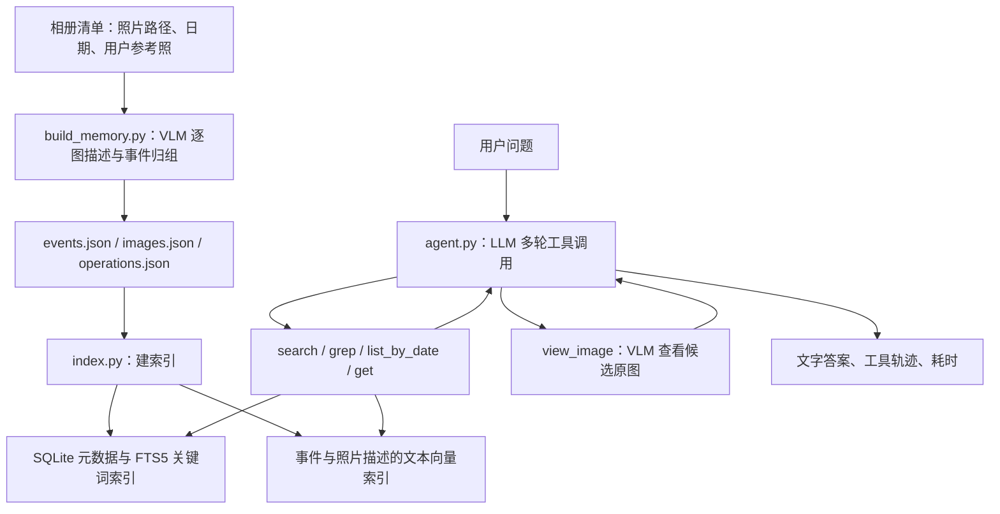

# CamRoll 源码与基本架构

观测日期：2026-09-15。本文依据拉取的源码静态阅读整理，未安装依赖、下载模型、构建记忆或运行问答。未连接或修改 `.100`、`.153`。

## 1. 源码来源与拉取结果

- 上游：[thaoshibe/camroll](https://github.com/thaoshibe/camroll)。现有 NX 资料中的上游地址与此一致。
- 本地：[camroll](/Users/zhanyiqi/Documents/camwwem/camroll)。这是独立 Git 仓库，不是 WeMM 服务目录，也不是 `clay384/camroll-nx` 实验分支。
- 分支：`main`；提交：`1967f977dbd51ce3f3b3b0d3213d21a514e55dfd`。
- 上游提交时间：2026-08-09T22:31:08-07:00；提交说明：`fix gemini_client`。
- 使用 `--depth 1 --filter=blob:none --no-checkout` 获取提交及目录树，确认当前提交不包含权重后检出。禁用 LFS 自动下载，并将跳过 LFS 下载的配置保存在该仓库本地。
- 检出后整个目录约 22 MiB（含 `.git`、网页和示例资料）。没有拉取 Hugging Face 模型或完整相册数据集。

## 2. 当前 WeMM 项目背景

WeMM 是媒体向量检索实验：图片、视频片段、PDF 页面及文本经预处理进入 `tencent/WeMM-Embedding-9B`，得到 4096 维向量；查询通过精确点积排序，返回媒体和排名。目前没有答案生成、在线 router、身份识别或元数据查询服务。

2026-09-14 PhotoBench 图片主测为 800 题、334 张候选图片。原问题 Hit@1/5/10 为 80.25% / 95.63% / 97.63%；固定语义改写和关键词方案没有改善总体图片召回。这些是历史实验结果，仅衡量已标注证据，不能当作问答准确率或服务器实时状态。

详见 [WeMM 架构](ARCHITECTURE.md)、[测试与结果](TESTS_AND_RESULTS.md)、[交接说明](HANDOFF.md)。本次用户授权扩展至本地 CamRoll 拉取与阅读，远端禁止写入约束仍有效。

## 3. 总体数据流

CamRoll 面向个人相册视觉问答，核心是“事件 → 照片描述 → 原图”的分层记忆。VLM 指能理解图片的模型，LLM 负责问答与工具选择。

图中是逻辑关系；代码通过五个独立工具读取不同存储，没有统一融合排序器。

## 4. 三个阶段

### 阶段一：生成分层记忆

入口：[build_memory.py](/Users/zhanyiqi/Documents/camwwem/camroll/camroll-agent/camroll_agent/build_memory.py)。

- 输入 conversation JSON：`root_folder`、`profile_image`、`library_description`、`turns`。用户参考照必需，支持 JPG/JPEG/PNG/WebP。
- 按 `turns` 的给定顺序处理；程序本身不自动按 EXIF 排序，日期来自清单。准备输入时应先整理时间顺序。
- 每步把用户参考照和当前照片交给 VLM，同时提供最近若干照片的文字记录（默认 3 条）、最新事件摘要和日期等上下文。
- VLM 生成 caption、location、people，并决定 `ADD` 新事件、`UPDATE` 最新事件或 `NO_OP`。这是顺序增量归组，不是对全相册执行一次聚类。
- 写出 `events.json`、`images.json`、`operations.json` 及 CSV；支持 checkpoint 与 resume。
- 单图调用异常会写入 `[skipped: ...]` 占位记录并继续。因此“流程结束”不代表每张图都成功描述，需要检查操作日志。

人物和地点主要来自模型描述。用户参考照提供身份上下文，不等于已有经过验证的人脸识别系统。

### 阶段二：建立可查询索引

入口：[index.py](/Users/zhanyiqi/Documents/camwwem/camroll/camroll-agent/camroll_agent/index.py)、[store.py](/Users/zhanyiqi/Documents/camwwem/camroll/camroll-agent/camroll_agent/store.py)、[vector.py](/Users/zhanyiqi/Documents/camwwem/camroll/camroll-agent/camroll_agent/vector.py)。

| 存储 | 内容与实现 |
|---|---|
| `metadata.sqlite` | events、images 表，日期、地点、人物及事件关联 |
| SQLite FTS5 | 事件名称/描述；照片 caption 前拼接事件名称及摘要，通过 BM25 排序 |
| `vector_store/records.json` | 事件文本和照片描述文本及其来源记录 |
| `vector_store/manifest.json` | embedding 模型、维度、记录数、存储后端 |
| `memory.index` 或 `vectors.npy` | 归一化文本向量；FAISS `IndexFlatIP`，不可用时退回 NumPy 点积 |

默认 embedding 为 `text-embedding-3-small`；可选本地 sentence-transformers 或自定义 `embed_many` 客户端。向量输入包含事件/日期/caption 等文字，不是照片像素。FAISS 这里使用精确内积索引，并未实现近似向量搜索。

图片 ID 是路径的短 SHA1，事件 ID 由名称和起始日期生成；不同于 WeMM 对文件内容做 SHA256 去重。索引阶段先清空 SQLite 旧记录再重建，不能当成无副作用读取。

### 阶段三：Agent 检索与问答

入口：[agent.py](/Users/zhanyiqi/Documents/camwwem/camroll/camroll-agent/camroll_agent/agent.py)、[tools.py](/Users/zhanyiqi/Documents/camwwem/camroll/camroll-agent/camroll_agent/tools.py)。

LLM 根据问题选择工具，读取工具结果后继续选择，最终输出文字答案。这就是这里的 ReAct 循环。

| 工具 | 用途 |
|---|---|
| `search` | 对事件和照片描述做语义检索，可限定类型、日期；日期/类型过滤发生在召回候选之后 |
| `grep` | FTS5/BM25 关键词检索，支持日期过滤 |
| `list_by_date` | 按日期查询，可附加地点和人物条件 |
| `get` | 取完整事件或图片记录；事件记录包括关联图片 ID |
| `view_image` | 将候选原图和具体问题交给 VLM，检查文字描述可能遗漏的视觉细节 |

默认最多 25 轮工具调用循环、5 次 `view_image`；每次看图最多 6 张。一个循环可包含多个工具调用。到轮数上限后请求最终文字答案；返回答案、工具轨迹、轮数、看图次数、停止原因与耗时。

工具 schema 要求 `thought` 字段作为调用理由。Python `Agent` 需要显式提供 VLM 才能看图；CLI `ask` 会构建该客户端。

## 5. 模块与模型边界

| 文件/目录 | 职责 |
|---|---|
| `camroll-agent/camroll_agent/cli.py` | inspect / build / index / run / ask 命令 |
| `llm/base.py`、`llm/__init__.py` | VLM/LLM 接口与后端工厂 |
| `llm/openai_client.py`、`gemini_client.py` | 云端模型调用 |
| `llm/local_client.py` | 本地 VLM，默认 Qwen2.5-VL-7B |
| `llm/qwen_llm.py` | 本地工具调用 LLM；默认按 CUDA 可用性选择 Qwen2.5-Coder-7B 或 Qwen2.5-1.5B，可配置覆盖 |
| `prompts.py`、`schemas.py` | Agent 提示词、观察结果格式、工具参数 |
| `page/`、`index.html`、`yfcc_users/` | 项目展示网页、demo 和展示资料 |
| `data/` | 数据集整理和校验脚本 |

核心交付是 Python 包与 CLI。网页展示文件不能等同于已经部署、可处理任意新问题的问答后端。

仓库没有独立的“RAG 权重包”。模型下载发生在运行本地 VLM/LLM 的 `from_pretrained` 或本地 sentence-transformers 初始化时。本次只读取源文件，没有实例化模型、执行 CLI、安装依赖或调用云端推理。

## 6. 与 WeMM 的关系

| 维度 | 当前 WeMM | 上游 CamRoll |
|---|---|---|
| 主要目标 | 找相关媒体并排序 | 检索证据并回答相册问题 |
| 检索表示 | 媒体直接编码为向量 | 事件和照片描述编码为文本向量 |
| 记忆组织 | 数据集 → 资产 → 单元 | 事件 → 照片描述 → 原图 |
| 查询策略 | 一次编码、相似度排序 | LLM 多轮选择工具、必要时看图 |
| 元数据 | 当前实验未用身份/元数据增强 | 提供日期、地点、人物字段及查询 |
| 媒体范围 | 图片、视频、PDF、文本 | 此版本建记忆入口以照片为主 |
| 输出 | Top-K 媒体、分数 | 答案及工具调用轨迹 |

架构推断：未来可把 WeMM 作为 CamRoll Agent 的额外媒体召回工具，补充 caption 检索遗漏的视觉信息。但这需要适配媒体 ID、数据集、结果格式与看图路径，并重新评测；当前没有完成集成。直接替换 CamRoll 的文本 embedding 也不会自动变成图片向量检索。

本次验证范围：核对 Git 提交、工作区状态、全部受跟踪文件及大小，静态阅读核心链路。没有运行性能、准确率或部署验证。
